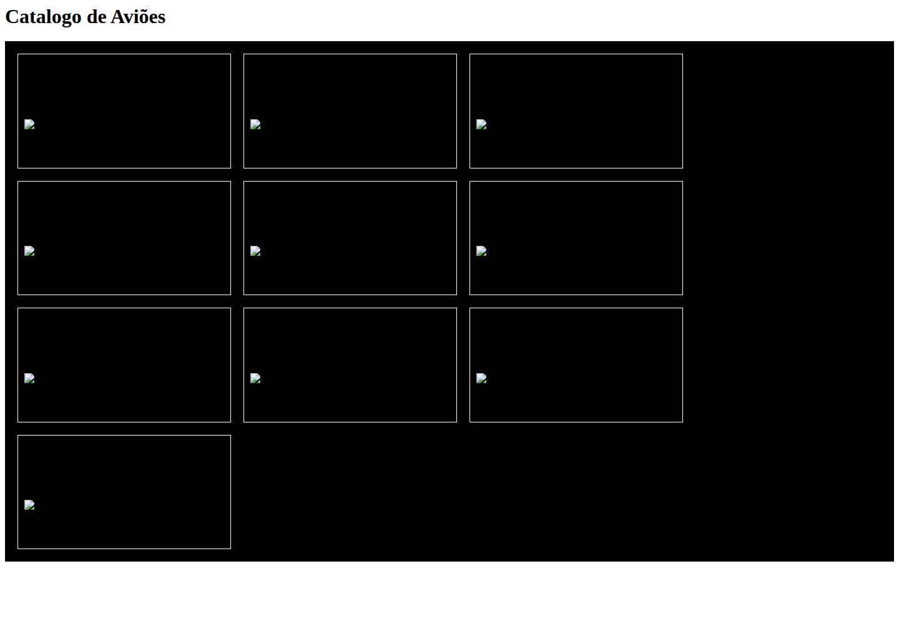

# Catálogo de Aviões — aula de Docker

Projeto de aula com PHP, MySQL e Docker Compose.



Captura do estado atual da interface usando os registros de exemplo de `mysql/init.sql`. Os links externos das fotos não carregaram no ambiente de captura e os cartões apresentam texto preto sobre fundo preto; essas limitações existentes estão visíveis na imagem.

## Executar

```sh
docker compose up --build
```

Abra http://localhost:8080 para o catálogo e http://localhost:8081 para o phpMyAdmin.

O projeto utiliza credenciais de exemplo para estudo local. O campo `ano` consultado pela página ainda não existe no esquema SQL; por isso, os anos não aparecem preenchidos.
